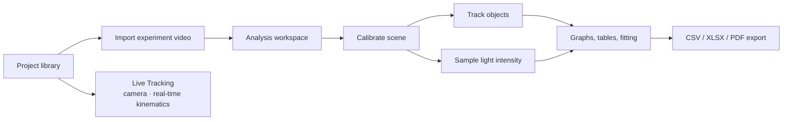

# PhysicsTracker Project Home

> Native Android physics video-analysis application. Users import an experiment video, calibrate it, track objects or sample light intensity, analyse scientific data, and export results.

## Navigate

- [[Product Mind Map]] — product at a glance
- [[Feature Relationship Map]] — feature dependencies and implementation status
- [[System Architecture]] — components and data flow
- [[Dependency Graph]] — dependency chains and bottlenecks
- [[Development Plan]] — priorities, phases, open questions
- [[Architecture Decision Log]] — consequential decisions
- [[Gap Analysis]] — risks and missing capabilities
- [[Research Evidence Audit]] — research manuscript, reproduced results, and experimental validation limits
- [[Research Development Methodology]] — Research–Plan–Execute–Validate cycle, historical BMAD planning, and application-focused paper

## Current system facts

- **Platform:** Android, Kotlin, Jetpack Compose; package `com.physicstracker`.
- **Persistence:** local Room database (`physics_tracker_db`), schema version 8 (`live_sessions`, `metaJson`).
- **Backend/API:** none. The app is local-first and uses Android platform APIs rather than a network service.
- **Media and ML:** Media3 playback; classical template/geometry tracking; optional MediaPipe detection and LiteRT model paths. CameraX feeds the offline [[Live Tracking]] pipeline.

## Core user journey

## Maintenance

See [AGENTS.md](../../AGENTS.md). Update the linked vault pages in the same change as the code or documented product decision.
