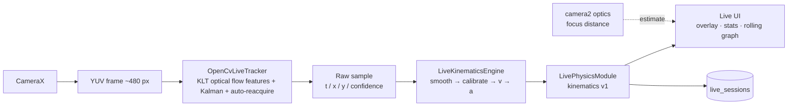
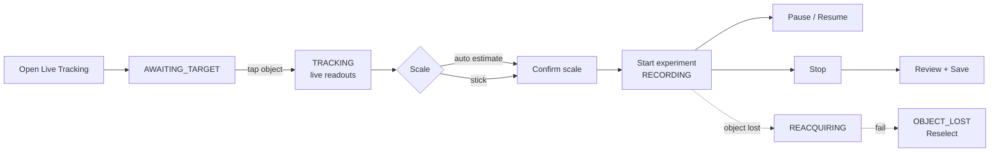

# Live Tracking

**Status:** Implemented (v4: workspace-parity UI — TRACK/ANALYSIS/CAL/SETTINGS tabs reusing the experiment `AnalysisWorkspace`, shared `GraphCanvasWidget`, shared fitting; KLT tracking; experiment conversion). Desktop verification green; on-device interactive verification of the v4 UI pending

## Purpose and value

Tracks a single object with the device camera in real time and shows calibrated physics
(position, velocity, acceleration) and a rolling graph **while the experiment happens**.
This is a separate acquisition workflow: it never records or processes video files and
does not touch the video-based [[Motion Tracking]] pipeline.

## Pipeline

- Camera frames never touch the UI thread: analysis runs on a dedicated single-thread
  pipeline (`LiveTrackingViewModel`), frames are dropped rather than queued when busy.
  Pipeline exceptions are contained per frame (never crash the app).
- Timestamps come from the sensor (`ImageProxy.imageInfo.timestamp`), not the wall clock
  and never an assumed frame rate.
- The tracker contract is `LiveTracker` (`live/LiveTracker.kt`). The production
  implementation is `OpenCvLiveTracker` (OpenCV 4.5.3, bundled native libs): Shi–Tomasi
  corner seeding around the tap + pyramidal Lucas–Kanade optical flow with
  forward-backward consistency + Kalman-smoothed median center + prediction-driven
  auto-reacquisition. `RobustLiveTracker` (SSD+HSV fusion) remains as a native fallback
  if OpenCV fails to initialize. An ML tracker can be plugged in behind the same interface.
- Gestures: tap selects the target only while it awaits selection; a normal tap never
  changes the locked target; long-press = reselect.
- Physics values are only shown when a scale calibration is **confirmed by the user**
  **and** the confidence gate accepts the measurement.
- Calibration: automatic pinhole estimate from camera optics (focal length, sensor size,
  per-frame focus distance via Camera2 interop) presented as an estimate requiring user
  confirmation; manual reference-stick calibration remains as the validated fallback.

## Workflow (implemented)

## Depends on

- `tracking/ClassicTrackerEngine.kt` (reused unchanged) and its native-style SSD matcher.
- `ui/CalibrationMath.kt` `calibrationUnitFactor` for unit handling.
- New `live/` package: models, kinematics engine, physics module interface, pipeline
  ViewModel, CameraX preview/overlay screen, `live_sessions` Room storage.

## Screens and APIs

- Home screen offers two halves: **NEW** (Live / video experiment) over **HISTORY**
  (projects, live runs badged as Live).
- `live/ui/LiveTrackingScreen.kt` hosts a workspace with the same interaction model as
  the video workspace: main tabs TRACK / ANALYSIS / CAL / SETTINGS, contextual controls
  only. The ANALYSIS tab composes the shared `AnalysisWorkspace` + `GraphCanvasWidget`
  + `fitProfile` from the live dataset; saved runs open in the full experiment
  workspace via [[ADR-006 Live runs become Experiments]].
- Orientation is manual-only: PORTRAIT (default), LANDSCAPE, or APP preference, chosen
  in SETTINGS and applied at the activity level.
- CameraX `Preview` + `ImageAnalysis` bound in one `UseCaseGroup` with a shared
  `ViewPort` so overlay coordinates map exactly to analysed frames.
- No network API. Camera permission (`CAMERA`) is the only new permission.

## Guardrails

- Live Tracking is an independent module: no changes to video tracking behaviour, its
  screens, or its stored data.
- Confidence-gated recording: lost / low-confidence frames never enter the kinematics
  stream; time gaps break smoothing segments.
- Recorded data stays in-memory (bounded rolling buffers) until the user explicitly
  saves a session; only then is it written to `live_sessions`.

## Integration with Experiments

Saving a live run writes the raw `live_sessions` row AND converts it into a first-class
[[Project Library]] experiment (project + calibration + tracker + `track_points`,
`LiveExperimentConverter`), so it opens in the existing [[Scientific Analysis]] workspace
without import/export. Coordinate space is `SOURCE_VIDEO` over the analysis frame; the
origin is the first recorded sample. The video area shows a media-error placeholder
because live experiments have no video file (see limitations).

## Known limitations

- Single-tracker only; no A/B identity concept.
- Calibration covers scale only (no origin axes); positions are relative to the first
  recorded sample.
- Live experiments carry no recorded video; continuous capture was intentionally kept
  off the real-time pipeline (latency/thermal risk). Data replay/analysis is the
  alternative. Video association remains a possible future extension.
- IMU (gyro/rotation-vector) device-motion compensation is not implemented: valid
  separation needs full scene homography compensation and would otherwise show false
  precision. Sensor preservation hooks remain a documented future extension.
- Automatic scale estimate quality is bounded by the device's reported focus distance;
  it is always presented as an estimate to confirm, and devices with fixed-focus/unreliable
  readings simply fall back to the reference-stick workflow.
- A device rotation remaps tracking coordinates and restarts filtering/origin honestly
  (segment break); a recorded run should ideally keep a fixed orientation.
- Marker auto-detection (e.g. detecting a known-size reference without taps) is not
  implemented; reference-stick taps are the validated manual path.
- Preview FPS on very low-end devices depends on the ~480 px analysis conversion cost.
- Physical-device matrix validation (rotations, high-FPS, low-end) is in progress.

## Related

[[Motion Tracking]] · [[Calibration and Kinematics]] · [[Scientific Analysis]] ·
[[ADR-004 Live tracking as an independent real-time module]] · [[Gap Analysis]]
