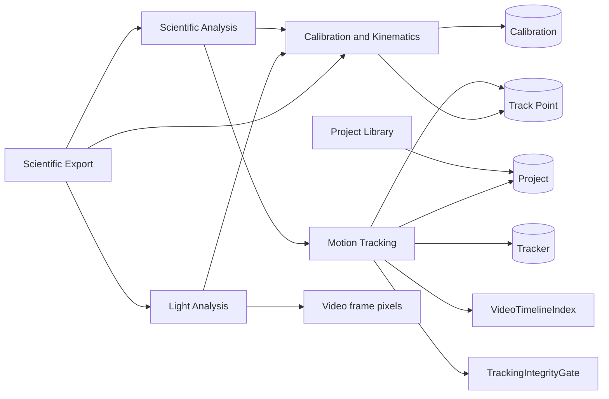

# Dependency Graph

## Critical dependency chains

| Chain | Bottleneck / failure consequence |
|---|---|
| Video timing → [[Track Point]] → [[Calibration and Kinematics]] → [[Scientific Analysis]] → [[Scientific Export]] | Incorrect time/frame identity corrupts downstream scientific output. |
| [[Calibration]] → kinematics/light distance labels → exports | A stale or mismatched calibration makes physically labelled values invalid. |
| Tracker identity → points → graph/table/export filtering | Any mixed A/B source produces plausible-looking but invalid comparison data. |
| Source-coordinate transform → overlay gestures → stored position | View/source mismatch makes manual and light selection inaccurate after zoom/pan/rotation. |

## No remote API chain

There are currently no HTTP APIs, backend services, cloud database, analytics collector, or third-party account integrations. Add them here and to [[System Architecture]] before implementation.
