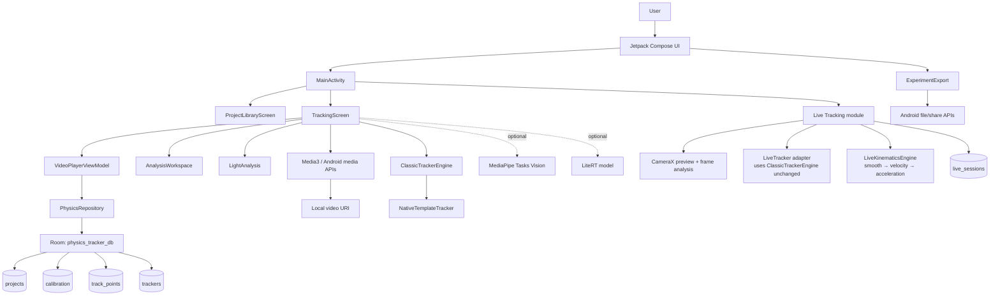

# System Architecture

## Implemented architecture

The bottom row (implemented) is the independent real-time camera pipeline added by
[[Live Tracking]]; it shares no state or tables with the video workflow above.

## Boundaries

- **Installation isolation:** debug builds use `com.physicstracker.test` / PhysicsTracker Test to coexist with the Google Play-signed production app. Release retains `com.physicstracker`. Each has independent app-private projects and permissions; FileProvider authorities derive from the application ID. No uninstall or automatic cross-app data migration is performed.

- **Presentation:** Compose screens and view state. `TrackingScreen.kt` is the current integration hotspot.
- **Domain/scientific logic:** calibration, kinematics, source/view transforms, graph fitting, light sampling, tracking integrity policy.
- **Data:** Room entities/DAOs behind `PhysicsRepository`; injected through Hilt. Live sessions use their own `LiveSessionDao` in the same database.
- **External integrations:** device-local media/document/camera APIs and optional packaged/imported ML models. No server calls are implemented.

## Important data flow

1. The app reads a local video through Android/Media3 and establishes frame timing via `VideoTimelineIndex`.
2. User or auto tracker writes a [[Track Point]] with source coordinates and timing/provenance fields.
3. [[Calibration]] transforms pixels to scientific units for kinematics and graphs.
4. [[Scientific Export]] derives output from the active, scoped analysis rather than a mixed raw-data dump.
5. [[Live Tracking]] runs a second, isolated flow: CameraX frames → `LiveTracker` → sensor-timestamped kinematics → rolling UI plus explicit session saves to `live_sessions`.

## Component links

`ProjectLibraryScreen` separates Start/Projects/Learn presentation with saveable tab/filter state. Existing navigation and repository callbacks are unchanged; history and learning content are composed only in their relevant tab. See [[Project Library]].

[[ADR-010 Home cards separate new work from saved work]] keeps a small drill-down state inside `ProjectLibraryScreen`: card body → type-filtered saved list → existing open callback, with Back to Start. `MainActivity` retains home saveable state while workspaces are open, and uses Android's document picker for a new Light photo/video. No project storage format or scientific data flow changes.

`ExperimentWorkspaceFrame` applies the established motion split to [[Light Analysis]]: full-height left media, right header/tool tray/navigation in landscape, bounded bottom tray in portrait. Shared experiment media/tool proportions also feed `TrackingScreen`; sampling still receives source coordinates through the existing selection transform. This is presentation-only and adds no analysis or storage pipeline.

The shared `MainBottomNavRow` now takes an active workspace mode. Motion renders Calibrate/Tracking while Light renders Light; Data/Play/View/More retain their common placement and components. The Light media stage contracts as its sidebar expands, keeping floating results out of the tool area. The Light ViewModel accepts gesture geometry only with the current tool type; explicit tool selection remains the sole type change. See [[Light Analysis]] and [[ADR-008 Shared workspace and persistent light projects]].

[[Project Library]] uses `DemoCatalog` and `DemoPicker` to copy bundled teaching media into durable app-private storage and route to the existing motion/light workspace. `PhysicsTrackerLogo` is shared by home and motion headers; launcher assets use the same supplied image. Demo conversion notes remain distinct from scientific source decoder metadata and are included in light provenance. Package and persistence identities are unchanged by visible branding.

[[ADR-008 Shared workspace and persistent light projects]] reuses `MainBottomNavRow` and `FloatingOverlayChrome` across motion and light. Light samples and raw provenance remain isolated, while `LightProjectStore` saves versioned streaming snapshots with recoverable replacement. The library combines those summaries with existing Room history; no motion/live schema downgrade or migration is introduced. A generated synthetic clip powers a guided first-use flow.

The dedicated [[Light Analysis]] path is `LightAnalysisScreen` → `LightAnalysisViewModel` → source-pixel sampling and real decoder timestamps. `LightTools` derives optional processed views from unchanged raw datasets; `LightSpreadsheet` restores XLSX alongside PDF/CSV without using motion-track records. Region identity and raw/derived provenance remain explicit.

The Light screen now resolves drag targets at the view boundary, applies edits in source coordinates, and shows a tool-column graph as the independent Light decoder publishes time samples. Decoder publication is paced by actual presentation timestamps for the visible tracking run; snapshots and exports still use the existing raw Light datasets. This presentation and acquisition scheduling change does not alter Motion or Live data flows. See [[Light Analysis]].

`LightAnalysisDesk` is a full-window presentation of the existing Light datasets. Its Graph, Table and Compare tabs share region selection and processing state with the media-stage floating panels; it does not own a second sampling or storage pipeline. View video frame returns to the media stage and decodes the selected source timestamp. See [[Light Analysis]] and [[ADR-008 Shared workspace and persistent light projects]].

[[ADR-009 Scalable light regions and playback-paced results]] extends the Light snapshot reader's bounded region count without changing its binary field order. Region labels and colours are presentation identities; each geometry and dataset remains separately keyed. The Light decoder still records real PTS while its publication clock uses the user playback rate. `LightStatistics` derives a linear fit from the selected processed view without altering raw observations.

The Add Region action now constructs a new Point, Line or Box geometry from the active tool through `LightTools`, then stores it under the next independent letter. Selecting a letter exposes its own tool and result; changing that tool invalidates only its dataset. The sampling and snapshot schemas are unchanged.

`LightAnalysisScreen` keeps the selected region's Start/Measure/Stop action in its fixed header and leaves the active tool tray mounted while acquisition runs. `ExperimentWorkspaceFrame` provides a dedicated landscape button to expand/restore the tool column and a separate drag grip for continuous resizing; touches elsewhere on the divider do not change width. These are presentation and input changes; the Light ViewModel remains the acquisition owner.

Calibration presentation now uses `CalibrationViewport` at the view boundary: source calibration/draft → video viewport overlay → inverse edit → source persistence. It shares the pixel-centre projection with the locator; graphs and exports continue to consume source calibration through `CalibrationMath`. See [[Calibration and Kinematics]].

[[Motion Tracking]] · [[Live Tracking]] · [[Light Analysis]] · [[Scientific Analysis]] · [[Scientific Export]] · [[Dependency Graph]]

## Research evidence boundary

[[ADR-007 Benchmark-gated blur-aware offline tracking]] adds a debug-only offline boundary: bulk bitmap read → local patch candidates → quality/ambiguity checks → integrity gate → measured observation or bounded recovery/missing frame. `BlurTrackingState` belongs to one tracker. Clear references freeze on uncertainty. Existing Classic/LIVE defaults, schema, calibration and LIGHT remain unchanged. [[Motion Tracking]] records incomplete decoding, review and performance work; this is not a validated replacement pipeline.

[[Research Evidence Audit]] separates the Android production engines from the Python offline benchmarks; their confidence calculations are different. `NativeTemplateTracker` in this checkout is a Kotlin compatibility implementation, not evidence of a linked C tracker. The current schema is version 8 as recorded in [[Project Home]]. The manuscript reproduction does not validate the full Android acquisition pipeline.
